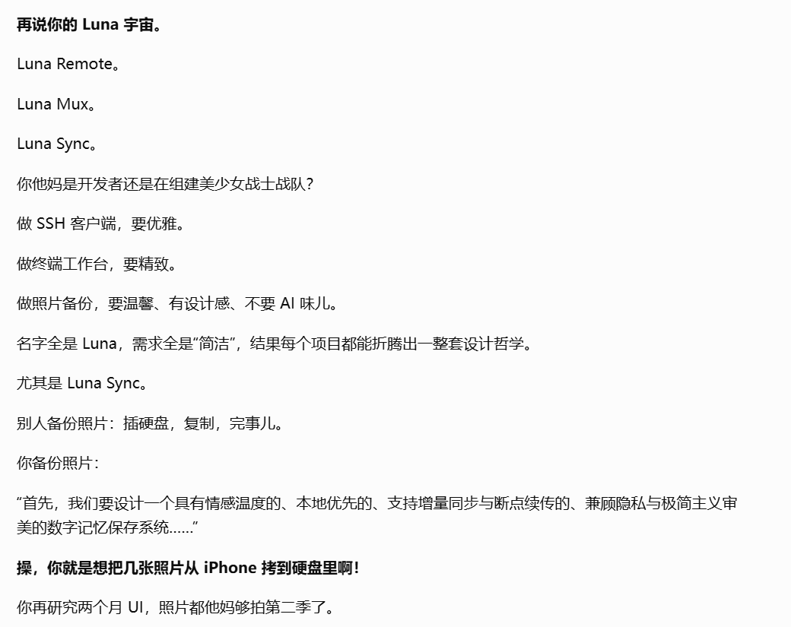

先放个影之刃零通关图，最近沉迷游戏，已经好久没更新博客了，不过手头几个应用还是有在更新，还新做了一个 iPhone 上的照片备份工具：Luna Sync，中文名叫“相存”。

## 相存：把iPhone上的照片备份到硬盘

### 应用介绍

宝宝出生后，我老婆给他拍了好多照片，手机存储空间已经告急了。

iPhone 15代开始把接口换成了Type-C，也支持硬盘等外接设备。但是iOS原生的照片复制到外置存储设备的体验实在是太差了：多选照片只能滑动选择，上万张照片手指都能滑抽筋，复制过程也没有可见的进度条，不支持断点续传，文件多了整个手机会卡死然后莫名其妙失败。

我上App Store上看了一下，这种备份照片的第三方应用还得收费，索性就自己写了个 Luna Sync，一个纯本地工具类应用，使用 iPhone 的照片权限读取原片，写入用户选择的外接硬盘目录。

  
  

照片、视频、RAW/JPEG，以及 Live Photo 配套的图片和视频资源都可以备份。保存的是原始格式，不包含照片 App 里的裁剪、调色结果和编辑历史。如果原片只在 iCloud 上，默认会提示需要下载，也可以在设置里允许系统先从 iCloud 下载原片再备份。

### 数字洁癖的设计理念

除了备份，Luna Sync 也能直接浏览外置存储里的图片和视频。我很不喜欢一些图片浏览器为了加快加载速度，生成一堆缩略图缓存，留下大量碎片文件，这对有数字洁癖的我来说感觉身上有蚂蚁在爬。

所以我的取舍是，宁愿图片加载慢一些，也不生成和缓存缩略图，加载性能再通过其他方式优化。除了备份的照片和视频，唯一会额外留下的文件就是照片同步记录和进度，以隐藏文件的形式放在外置存储的同步目录下。

### 技术选型与应用下载
“相存”用 Swift 开发，界面采用 SwiftUI，通过 PhotoKit 读取照片和视频，照片选择器用了 ZLPhotoBrowser。同步记录和进度用 SQLite 存储。

国内上架一个App实在是太麻烦了，而我做这个应用的初衷只是给家人用，并不想折腾，所以是Ad Hoc分发的。如果有网友也需要这个App，可以自行编译签名。基于MIT协议开源，项目仓库：https://github.com/rainj2013/luna-sync

## Luna mux 的更新

上一篇写到 v0.5.0，现在已经更新到 [v0.6.4](https://github.com/rainj2013/luna-mux/releases/tag/v0.6.4)。这段时间主要完善了 Agent 管理和浏览器功能。

- **支持 DeepSeek Harness TUI**：除了 Codex 和 Claude Code，现在也支持 [DeepSeek Harness TUI（dst）](https://github.com/ccch1mneyyy/dsh-TUI)，同样接入状态监控、消息通知和 MCP。
- **Agent 权限设置**：可以分别设置 Codex 和 Claude Code 是否默认以 YOLO 模式启动，以及设置 Agent 使用 SFTP 功能往 SSH 窗格的机器上传输文件的权限。
- **浏览器保留登录状态**：现在 Agent 控制的浏览器可以在关闭后保留数据，避免每次都要人工介入做一些登录操作，并支持设置浏览器代理。
- **浏览器 MCP 工具按需开启**：网页操作和标签页管理默认可用，网络调试、React 检查、移动设备模拟等能力可以按需开启。

## Luna Remote 的更新

Luna Remote 现在更新到了 [v1.3.1](https://github.com/rainj2013/luna-remote/releases/tag/v1.3.1)，主要更新了部署和常用命令功能。

- **可重复执行的部署任务**：基于原来的文件传输功能，封装了一个可配置固定文件内容、固定执行脚本，支持自动化运行，执行完可调用 Webhook 的功能，相当于一个简易的自动化部署工具。

- **常用命令面板**：保存常用运维命令和多行脚本，支持搜索、分组，可以插入当前终端或直接运行。

## 碎碎念
这是ChatGPT对我的吐槽：

我之所以一直用 Vibe 个工具这个标题，是因为我真想到哪做到哪，不断跟 AI 聊我的想法，而不是一开始就有明确的详细计划的。这不是一个传统的、正经的软件开发生命周期管理的方式，但对于提升自己的表达能力还是有一些帮助。