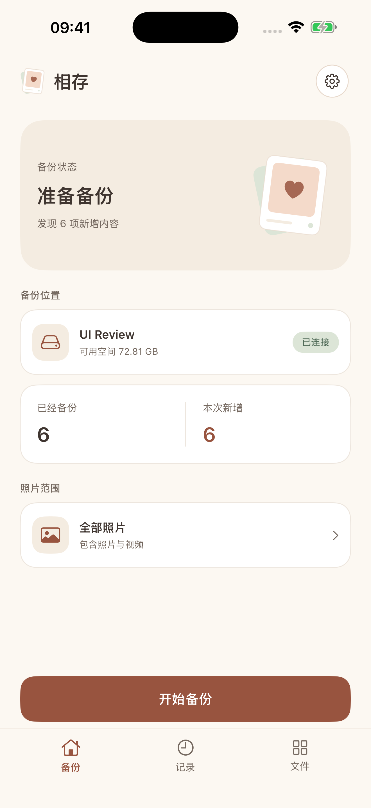
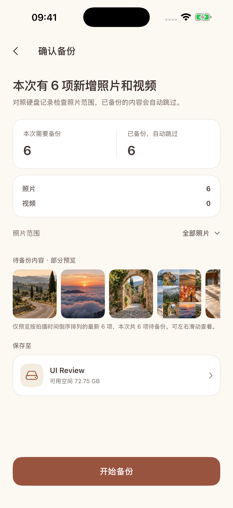

[上一次](/?post=vibe个工具系列03-agent-工作台-luna-mux-更新和一些设计理念)分享了 Luna mux 的更新和一些设计想法。这次换一个方向，做了一个 iPhone 上的照片备份工具：Luna Sync，中文名叫“相存”。另外，Luna mux 和 Luna Remote 这段时间也有一些更新，放在后面一起聊聊。

## 把照片备份到硬盘

手机里的照片和视频越来越多，除了云端备份，我也想在自己的硬盘里留一份原始文件。最好不用先把照片导到电脑上，再从电脑拷到硬盘，而是把硬盘接到 iPhone，选好范围，就可以直接备份。

第一次备份可能比较久，后面只需要处理新增的照片。中途断开了，下次接上还能继续。备份出来的文件也应该能直接打开，不需要依赖专门的软件才能读取。

所以就有了 Luna Sync。它不需要账号，也没有配套服务端，使用 iPhone 的照片权限读取原片，写入用户选择的外接硬盘目录。支持 iOS 18 及以上版本，硬盘需要能被系统“文件”App 识别和访问。

操作流程比较简单：选择备份目录，选择照片范围，扫描后看看本次需要备份多少内容，确认后开始。范围可以选全部照片、今天、最近 7 天、最近 30 天、今年或自定义日期，也可以进相册逐张选择、滑动多选，或者点首尾两张，把中间的一段一起选中。

  
  

上图是模拟器里的应用界面，照片和容量数据用于展示。

照片、视频、RAW/JPEG，以及 Live Photo 配套的图片和视频资源都可以备份。保存的是原始格式，不包含照片 App 里的裁剪、调色结果和编辑历史。如果原片只在 iCloud 上，默认会提示需要下载，也可以在设置里允许系统先从 iCloud 下载原片再备份。

## 备份完成，要有依据

这个工具界面上的操作不多，但做起来花心思的地方主要在备份过程。

例如，一张 Live Photo 实际上不只有一个文件，图片写完了、配套的视频还没写完，不能算整张照片备份成功。复制过程中硬盘断开，留下的半个文件也不能在下次扫描时被当成已经完成。

Luna Sync 会先把资源写到临时文件，写完后重新读取，用 SHA-256 核对内容，再提交完成记录。一张照片对应的原始资源都处理完，才算这一张成功。备份记录也会保存在硬盘上，下次选择同一个备份目录时，根据记录跳过已完成的内容，继续处理新增和未完成的文件。

这里的“继续”是保留已经完成的文件，没传完的单个文件会从头重传，不是从中间某个字节接着传。每次扫描会快速检查已备份文件是否存在、大小是否一致，需要时也可以手动做完整校验，重新读取文件检查内容。

文件直接放在选中的目录里，保留原始文件名；遇到同名文件就加序号，不覆盖已有内容。硬盘接到电脑上，也能像普通文件一样查看和整理。

另外，虽然名字里有 Sync，但当前的功能是备份。它不会删除手机里的照片，也不会因为手机相册删了一张照片，就把硬盘上的对应文件一起删掉。

## 顺便浏览硬盘

既然硬盘已经接上了，我也希望能直接看看里面的照片和视频，所以又做了一个独立的文件浏览页面。

它和备份目录分开授权，可以从硬盘根目录逐层浏览，支持网格和列表、搜索、排序，以及图片和视频筛选。打开原文件后可以预览，也能左右切换，不局限于 Luna Sync 备份出来的内容。

使用时还是建议保持 App 在前台。iOS 26 上接入了后台继续处理能力，但本次能否继续取决于系统是否允许，传输页面会显示状态。任务被系统停止或硬盘断开后，已完成的内容会保留，重新连接原目录后再继续。

## 技术选型

前两个桌面工具都用了 Tauri，这次是 iPhone 应用，选择了 SwiftUI 和 PhotoKit。界面用 SwiftUI，照片原始资源通过 PhotoKit 读取，照片范围选择基于 ZLPhotoBrowser。

备份规划、校验和恢复逻辑单独放在一个 Swift 模块里，本机的 SQLite 只做缓存，硬盘上的记录才是恢复备份的依据。这样即使重新安装 App，本机历史和目录授权丢了，重新选择原目录并确认照片库来源后，仍然可以核对硬盘记录。

Luna Sync 目前先供自己和家人使用，还没有公开上架，安装方式也还没有前两个桌面工具那么方便。后面整理好分发方式再分享。

## Luna mux 的更新

上一篇写到 v0.5.0，现在已经更新到 [v0.6.3](https://github.com/rainj2013/luna-mux/releases/tag/v0.6.3)。这段时间主要是继续完善 Agent 工作台的使用体验。

除了 Codex 和 Claude Code，现在也支持 [DeepSeek Harness TUI（dst）](https://github.com/ccch1mneyyy/dsh-TUI)。在目标环境装好后，可以从菜单启动，也可以直接在终端里运行，同样能使用状态监控、消息通知、任务投递，以及 Luna Mux 和浏览器的 MCP。Agent 页面增加了概览和设置，可以集中查看当前会话的 Agent 状态、任务和待处理事项。

浏览器现在可以按项目会话保留登录状态和站点数据。之前让 Agent 查一个需要登录的平台，重启浏览器后可能又要人工登录，开启保留数据后会方便一些。另外增加了独立的代理设置，常用的网页操作和标签页管理默认可用，网络调试、React 检查、移动设备模拟等能力则可以按需开启，避免一次给 Agent 加载太多工具。

终端也补了不少细节：改善 emoji、组合字符的显示，支持 SIXEL 图片，让一些终端应用可以直接在窗格里展示图片；修复了 macOS 全屏时输入区被裁切、切换视图后滚轮失效等问题。这些不算特别显眼的功能，但每天都在用的时候，少遇到一次显示错位或输入异常，体验就好一点。

Agent 设置里还增加了启动权限选项，可以分别设置 Codex 和 Claude Code 是否默认以 YOLO 模式启动，也就是跳过相应 Agent 的审批或权限确认。通过 MCP 发起 SFTP 上传下载则有单独的授权开关，默认关闭，开启后才允许 Agent 使用，遇到同名文件时仍需要确认怎么处理。

## Luna Remote 的更新

Luna Remote 现在更新到了 [v1.3.1](https://github.com/rainj2013/luna-remote/releases/tag/v1.3.1)，这次比较大的变化是把原来的目录部署扩展成了可保存、重复执行的部署任务。

可以从本地工作区选择多个文件或目录，执行前预览内容，选择打成 ZIP、tar.gz 上传，或者按原目录结构直接上传。上传完成后，再通过 Bash 模板做解压、复制、重启服务等操作。部署用的脚本也可以让内置 AI 助手协助生成。

例如，一个静态网站构建完成后，可以把构建目录压缩上传到服务器，再解压到实际站点目录。把这些步骤保存为任务，下次就不用重新选文件、敲解压命令。执行过程能看进度，运行历史里保留状态、耗时、命令输出和错误信息，也支持每日定时执行、任务导入导出和 Webhook 通知。

另外提供了部署 Web API，外部脚本可以查询任务、触发部署和读取结果。如果已经有自己的自动化流程，也能把它接进去。定时任务运行在桌面应用里，使用时需要让应用保持运行。

还加了一个我觉得很实用的常用命令面板。经常用的运维命令和多行脚本片段可以保存在本机，按名称、内容、说明和分组搜索，然后插入当前终端，或者直接运行。AI 适合帮忙写一条记不清的命令，已经确认过、反复要用的命令，存起来会更直接。

Luna mux 和 Luna Remote 的新版 macOS 安装包都加上了开发者签名和 Apple 公证，Intel 和 Apple Silicon 都支持。Windows 安装包仍未签名。两个项目的源码和安装包还是分别放在 [Luna mux](https://github.com/rainj2013/luna-mux) 和 [Luna Remote](https://github.com/rainj2013/luna-remote) 的 GitHub 仓库里。

## 碎碎念

这个系列最开始的想法，是借助 AI 把自己常用的软件重新做一遍，按自己的习惯调整。前两款是工作中用的工具，这次变成了生活里的照片备份。

做 Luna Sync 时，一个感受是，功能看起来越简单，越容易低估那些没有发生在正常流程里的情况。界面上只是一个“开始备份”按钮，但硬盘断开、原片在云端、文件重名、Live Photo 只写完一半，都需要想清楚怎么处理，怎么向用户说明。

AI 帮我跨过了不少技术栈的门槛，让我可以从 Rust、桌面终端做到 Swift 和 iPhone 应用。但什么情况能算完成、遇到异常怎么恢复、哪些操作需要用户确认，这些还是要自己决定。自己做、自己用，再把遇到的问题一点点补上，也是这个系列一直写下来的原因。
